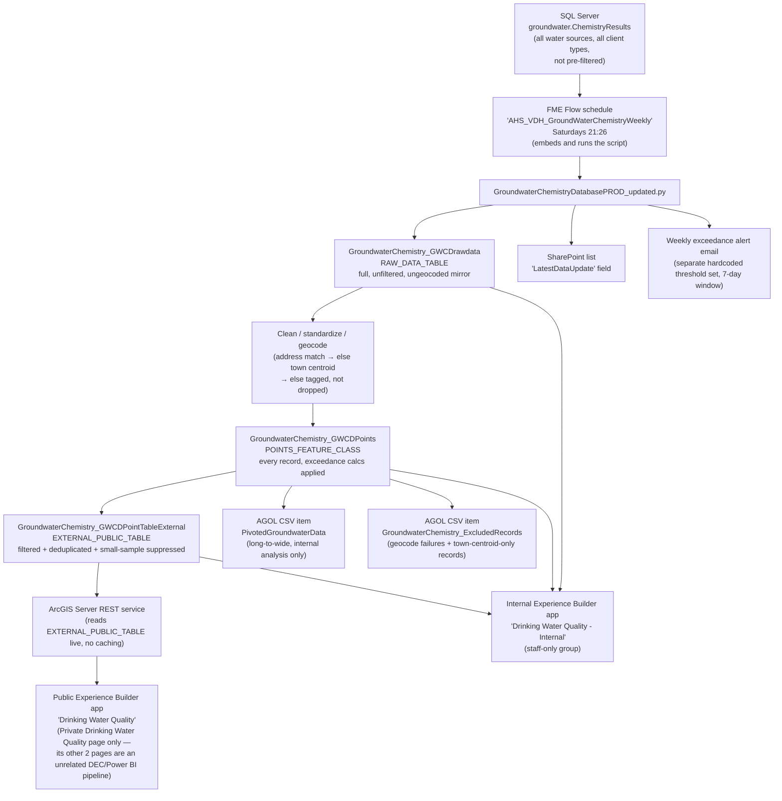

# Architecture — Ins and Outs

One weekly run of `GroundwaterChemistryDatabasePROD_updated.py` (triggered by FME
Flow — see [07-automation.md](07-automation.md)) touches every box below. Nothing
else writes to these destinations between runs.

## Reading this diagram

- **One source, one script, six destinations.** Everything downstream of
  `groundwater.ChemistryResults` is produced by a single weekly script run — there
  is no other process that writes to any of the GWCD tables/items/apps shown here
  (the only other FME workspace that touches `GroundwaterChemistry_GWCDPoints`,
  `EnvHealthGroundwaterChemistryDataPivotExport.fmw`, is a separate read-only
  export to an FME Server shared-resource CSV, not part of this pipeline, and is
  intentionally out of scope for this doc set).
- **`GroundwaterChemistry_GWCDPoints` is the hub.** It's the only table that feeds
  the public-facing path (via `EXTERNAL_PUBLIC_TABLE`), both internal-review CSVs,
  and the Internal app directly.
- **The public app and the Internal app read different tables**, not the same
  table with different filters applied client-side: the public app's ArcGIS
  Server service reads `EXTERNAL_PUBLIC_TABLE` live and dynamically (no caching —
  a data refresh is visible within one request), while the Internal app's three
  layers read `RAW_DATA_TABLE`, `POINTS_FEATURE_CLASS`, and
  `EXTERNAL_PUBLIC_TABLE` directly.
- **The two AGOL CSV exports and the weekly email are side channels** — none of
  them feed either Experience Builder app. They exist for internal
  analysis/review and staff notification only.
